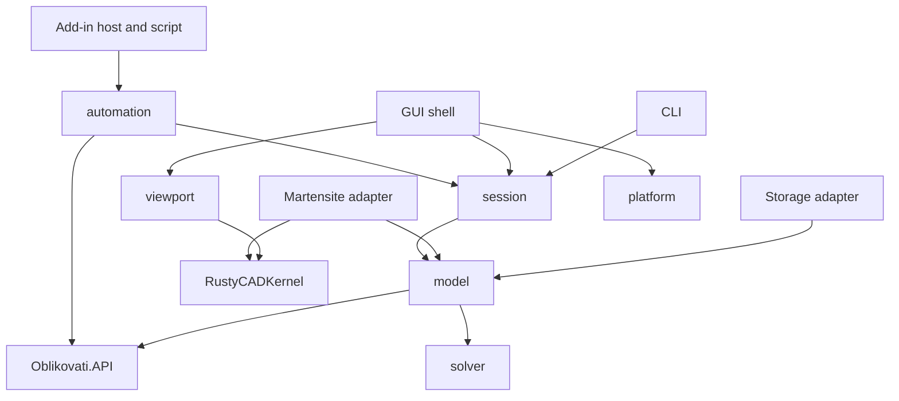

# Port the Oblikovati application to Rust

Date: 2026-10-10. Status: implementation started.
See the [implementation evidence](implementation.md) for tested behavior and limits.
The [feature sequence evidence](implementation-features.md) records the ordered
recipe foundation and the remaining replay integration work.

## Outcome

Build the desktop application and CLI in Rust, using `oblikovati-api` for the
public contract and Martensite for geometry, topology, and kernel operations.
Keep the document model, editable feature history, automation behavior, and
user workflows of the Go application. Verify these behaviors against a fixed
source revision and recorded tests.

The first useful result is a part that a Go or Rust add-in can create, edit,
save, reopen, and display. Complete the remaining application features in
separate milestones. A working extrude does not mean the port is complete.

The [source map](source-map.md) records the starting revisions. The
[milestones](milestones.md) define the work. The
[verification plan](verification.md) defines evidence required to close it.

## Scope and ownership

| Repository | Owns | Port action |
| --- | --- | --- |
| `oblikovati-rust`, branch `rust` | GPL application, feature recipes, documents, session, GUI, CLI, host | Implement the application in Rust. |
| `Oblikovati.API` | Apache public types, traits, wire declarations, clients, C ABI | Consume the Rust crate. Change the shared contract here first when required. |
| `RustyCADKernel` | Martensite geometry, topology, algorithms, and visualization | Integrate tested capabilities, complete missing OCCT behavior, and port required Go-kernel capabilities outside OCCT as Martensite extensions. |
| `Oblikovati.AddIns.*` | Separate add-ins | Keep the C ABI. Test existing Go add-ins against the Rust host. |
| `Oblikovati` | Go reference application | Read source and run comparison tests at the recorded revision. |

**Required scope: Go-kernel capabilities that support application features
and are not part of OCCT must be ported and adapted into Martensite.** OCCT
parity alone does not satisfy the application port. Absence from OCCT is a
reason to extend Martensite, not a reason to remove the application feature.

Use the Go implementation, tests, and fixtures as the starting point for these
extensions. Adapt them to Martensite's geometry, topology, ownership, numeric,
and operation-history interfaces. Implement them in `RustyCADKernel`; the
application adapter consumes them through the same tested kernel interface.
The [extension process](martensite.md#required-extensions-from-the-go-kernel)
defines classification, provenance, and acceptance.

Keep one production Rust kernel in Martensite. Do not create a separate copy
of the Go kernel inside the application, call the Go kernel over FFI, or link
native OCCT to supply a missing operation. Native OCCT and SolveSpace remain
test oracles where they cover the required behavior.

All application features found in the baseline remain in the port inventory,
including incomplete features. An unfinished Go roadmap item remains separate
feature work; the language port does not silently promise its completion.
Source presence, passing unit tests, and demonstrated user behavior are separate
states in the inventory.

## Architecture

Use a Cargo workspace with focused crates. Create each crate when its first
tested behavior is needed. The names below are proposed application package
names, not existing packages.

| Proposed crate | Responsibility and interface |
| --- | --- |
| `oblikovati-model` | Document recipes, IDs, parameters, units, sketches, features, assembly and drawing models, and health. Owns dependency and naming rules. |
| `oblikovati-solve` | The shared constraint solver for sketches and assembly placement. Receives explicit variables and residuals; returns status and achieved precision. |
| `oblikovati-martensite` | Kernel adapter: construct and evaluate shapes, return provenance and diagnostics, validate results, query analytic geometry, and tessellate. |
| `oblikovati-storage` | YAML documents, projects, resources, atomic writes, migrations, and preferences behind injected storage interfaces. |
| `oblikovati-session` | Commands, transactions, undo/redo, events, selection, tools, job scheduling, and document lifecycle. |
| `oblikovati-automation` | Implements the API traits and wire router against session operations. Classifies queries and edits once. |
| `oblikovati-addin-host` | Library discovery, C ABI, callback dispatch, buffer ownership, compatibility checks, and add-in lifecycle. |
| `oblikovati-viewport` | Martensite visualization adapter, camera, presentation, pick-to-reference mapping, overlays, and capture. |
| `oblikovati-shell` | Dear ImGui UI state, ribbon, browser, panels, dialogs, and input. Uses session operations. |
| `oblikovati-platform` | Native window, UI binding, clipboard, file dialogs, and other OS integrations. |
| `oblikovati-script` | Lua execution and its limits behind an application-owned interface; routes model calls through automation. |
| `oblikovati-cli` / `oblikovati-head` | Composition roots and shipped binaries. Select and inject concrete adapters. |

Keep internal modules under 500 lines and split by responsibility. Do not
rebuild the current large `app.Session` as one Rust struct with all UI concerns.
Session modules own their state; the composition root connects them explicitly.

The dependency direction is:

Arrows mean imports. The binaries inject concrete kernel and storage adapters
into model-owned interfaces. Keep model and solver independent of the window,
GPU, filesystem, and add-in loader. Only the kernel adapter and viewport import
Martensite toolkits. Keep native UI calls inside the platform module. Enforce
these import rules with workspace checks.

The kernel interface belongs to the model's evaluation needs. It hides shape
ownership, operation history, tolerance conversion, and validation. It is not
a second copy of every OCCT class. Use immutable recipe inputs and opaque,
revision-scoped shape references. Tests cross the same interface as features.
Use named fakes for external I/O; geometry correctness tests use Martensite.

## Contract and version rules

- Import `oblikovati_api::{types, contract, wire, client, ffi}`. Do not copy
  public DTOs, enum values, method strings, or ABI declarations into this repo.
- Keep contract changes in `Oblikovati.API/go` first, then regenerate the Rust
  declarations and run the two-language gate. Application CI consumes a fixed
  API revision and checks the supported method inventory against it.
- Implement the applicable Rust contract traits and typed wire operations.
  Preserve numbers, omitted fields, nulls, errors, transaction effects, and
  event order. Serialization parity alone is not host behavior parity.
- Retain existing add-in version exports and compatibility behavior. Do not
  claim full add-in compatibility while only part of the host is implemented.
  Early builds are development previews with a tested method inventory.
- API PR [#296](https://github.com/Oblikovati/Oblikovati.API/pull/296) is open
  at this plan's baseline. Pin its exact tested revision for early integration.
  Move to a released revision after its merge and release checks pass.
- The website change in
  [PR #7](https://github.com/Oblikovati/website-oblikovati.org/pull/7) must be
  deployed before the API release gate can pass. This is an upstream release
  dependency, not a reason to block local integration with a fixed revision.

## Runtime and ownership

One session owner commits model edits in order. GUI commands, CLI commands,
scripts, and add-ins use the same transaction path. The GUI drains a bounded
request queue and remains responsive while computation runs.

Workers receive immutable recipe snapshots and a document generation. They
return operation results, provenance, health, and presentation updates. The
session adopts a result only if its document and generation are still current.
Cancel work when possible; always discard stale results. Close, undo, and redo
must also invalidate stale jobs.

A cloned Martensite shape can share mutable storage. `Clone`, `Arc`, and even
`Send + Sync` do not prove that two evaluations can safely mutate the same
shape. Prove copy and mutation behavior in the early kernel check. Keep mutable
kernel state confined to one evaluation owner until that check passes. Do not
add unsafe thread traits to make a scheduling design compile.

Keep UI and viewer objects on their required thread. Define render-resource
retirement and shutdown order before moving work off that thread. No caller
may block the session thread while waiting for a callback that requires it.

## Documents and persistent identity

Keep the existing YAML recipe format and document kinds as the first storage
target: `.opd`, `.oad`, `.odd`, `.ord`, and project `.opj`. The current document
schema is version 2. Recompute geometry from recipes; do not make a serialized
Martensite shape the primary document representation.

Read the existing versioned `OKRK` reference-key envelope and supported legacy
keys. Replacing the kernel changes topology creation, so decoding the bytes
alone is insufficient. Prove that old references bind to the intended face,
edge, or vertex after recipe replay. Use operation provenance and semantic
feature roles. Never use pointer values, face iteration order, or nearest
geometry as persistent identity.

If an existing key payload cannot retain its meaning, define a versioned key
migration with an explicit old-to-new mapping. Preserve the original file and
report unresolved references. Do not silently rebind them or overwrite a file
that the port cannot fully represent. Full document compatibility remains an
exit gate, including projected geometry, attributes, mates, and dimensions.

## Viewport and UI direction

Use Martensite's Vulkan and visualization work as the target viewport. Retain
the current Dear ImGui workflow and UI assets while porting application logic
to Rust. A narrow native UI binding can remain; replacing the UI toolkit is a
separate decision. Reuse the existing window/UI stack only where it does not
bring back the Go application or its rendering engine.

Test native presentation, selection, overlays, resize, and ImGui composition
early. Martensite's current offscreen triangle rendering does not satisfy these
requirements. Record gaps in its capability ledger. Some Oblikovati features,
such as its OpenPBR workflows, may exceed the kernel's current renderer scope;
agree their ownership and acceptance before claiming visual parity. See the
[kernel integration plan](martensite.md).

## Architecture decisions and implementation evidence

The fresh Rust ADR set is recorded under `architecture/decisions`, numbered
`ADR-0001` through `ADR-0013`. The [legacy map](../decisions/legacy-map.md)
classifies all 66 Go ADRs. Applicable decisions are adapted to Rust and
Martensite and consolidated by architectural boundary. Old accepted labels
do not carry into this set.

Follow the [ADR policy and index](../decisions/README.md). The target designs
are accepted; their implementation proofs remain open. Keep dependency choices,
test receipts, and capability status in the implementation ledger. A design
change supersedes its accepted record; it does not silently edit that decision.

| Current Rust decision | Due | Required evidence |
| --- | --- | --- |
| [0001: application architecture](../decisions/ADR-0001-rust-application-architecture.md) | R0/R1 | Compile the crate boundaries, common toolchain, and fixed dependencies; verify ownership. |
| [0002: API and add-ins](../decisions/ADR-0002-api-and-addin-host.md) | R2/R4 | Trait/wire conformance and real Go/Rust C ABI lifecycle tests. |
| [0003: storage](../decisions/ADR-0003-documents-and-storage.md) | R2/R3/R6/R8 | Schema-2 recipes, resources, projects, and failure-safe round trips. |
| [0004: evaluation](../decisions/ADR-0004-session-and-feature-evaluation.md) | R2-R6 | Transactions, invalidation, stale-result rejection, and independent failure. |
| [0005: identity](../decisions/ADR-0005-identity-and-references.md) | R1/R3/R5/R6/R8 | Provenance and old-key replay without incorrect rebinding. |
| [0006: constraints](../decisions/ADR-0006-parameters-and-constraints.md) | R2/R3/R6 | Units, expressions, rank/DOF, achieved precision, and placement. |
| [0007: Martensite](../decisions/ADR-0007-martensite-integration.md) | R1-R8 | K01-K11, shape isolation, analytic results, and required Go-kernel extensions. |
| [0008: Vulkan](../decisions/ADR-0008-vulkan-renderer.md) | R1V/R4/R7 | Native presentation, GPU lifetime, styles, captures, and required extensions. |
| [0009: UI and selection](../decisions/ADR-0009-ui-and-selection.md) | R1V/R4/R7 | Native binding, input, tools, themes, editor, and visible selection. |
| [0010: assets](../decisions/ADR-0010-materials-and-appearances.md) | R5/R7 | Typed material/appearance round trips, assignment, and analytic properties. |
| [0011: scripting](../decisions/ADR-0011-scripting.md) | R7 | Lua 5.1, limits, cancellation, and containment with the selected engine. |
| [0012: validation](../decisions/ADR-0012-build-and-validation.md) | R0 onward | Full discovered workspace gate, independent oracles, platform/live evidence. |
| [0013: releases](../decisions/ADR-0013-packaging-and-release.md) | R9 | Reproducible packages, dependency pins, upgrade and rollback. |

Do not select a new YAML, Lua, window, or UI wrapper only from its name. Check
its current support, license notices, MSRV, and the required behavior in a small
test. The plan fixes the interfaces and acceptance criteria; those dependency
choices need evidence during their assigned milestone.

## Branch and work policy

Use `rust`, the repository default, as the integration branch for this new
application history. The former default `develop` is now `go-legacy`. Fetch
upstream for reference. Do not merge `go-legacy` with
`--allow-unrelated-histories`; that would restore the Go tree that this branch
was created to replace.

Current user policy: work on the single `rust-port` working branch. Integrate
any authorized delegated work there and keep granular commits. Fetch and merge
its upstream before publishing work. Create a PR only when the user requests
one. Kernel changes follow the separate Martensite integration workflow; API
changes follow the API workflow.

The [port epic #3563](https://github.com/Oblikovati/Oblikovati/issues/3563)
tracks the full application port. R0 creates the remaining milestone issues.
Use R0-R9 as stable planning IDs until real issue numbers exist. These IDs are
not claims that GitHub milestones or implementation issues already exist.
The tracker owns work status; these documents own design and acceptance.
